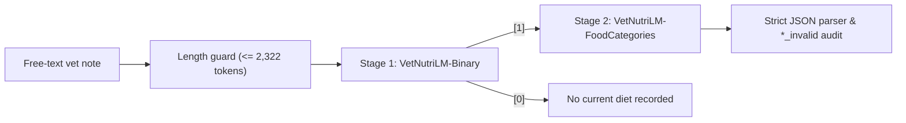

# VetNutriLM

[](https://github.com/robertjspencer/vetnutrilm/actions/workflows/ci.yml)
[](LICENSE)

Status: Manuscript in preparation · Code: Apache-2.0 · Adapters: pending custodian approval

**What this is, in plain terms.** VetNutriLM extracts structured nutrition information from free-text veterinary consultation notes. It consists of two separately trained 4-bit NF4 QLoRA adapters (rank 8, alpha 16, 22.5M trainable parameters each, attention projections `q/k/v/o`, answer-token-only loss) for Google's `google/gemma-4-31B-it`:

- **VetNutriLM-Binary** answers yes (`[1]`) or no (`[0]`): does the note record what the dog is currently fed, or was fed without stopping?
- **VetNutriLM-FoodCategories** marks six overlapping food types as a 6-element JSON array: commercial dry, commercial wet, raw, home-prepared cooked, therapeutic, and other. *(The frozen prompt and CSV schema in `src/vetnutrilm/prompts.py` retain the original training label `Therapeutic / prescription` for reproducibility.)*

This repository holds the code, prompts, and settings behind the manuscript results, a command-line tool to train or run either classifier, and a verification command that recomputes every reported figure. It contains **no clinical notes, labels, predictions, or adapter weights**.

## Pipeline



### Example (synthetic notes)

Using two invented rows from [`src/vetnutrilm/synthetic_notes.csv`](src/vetnutrilm/synthetic_notes.csv):

| Synthetic note | Stage 1 (Binary) | Stage 2 (6-class JSON) | Interpretation |
|---|---|---|---|
| *"Eats home-cooked chicken and rice most nights plus a tinned food in the morning."* | `[1]` | `[0, 1, 0, 1, 0, 0]` | Commercial wet + Home-prepared cooked |
| *"Advised owner to consider a weight-management diet. No current diet recorded."* | `[0]` | *(not run)* | Advice alone does not count as current feeding |

## Internal validation results

Grouped five-fold cross-validation on Australian primary-care canine notes from VetCompass Australia. Notes from the same dog, or with identical text after case/whitespace normalisation, were kept in the same fold. 95% intervals resample whole linked groups (2,000 bootstrap replicates, seed 42).

| Task | Notes | Result |
|---|---:|---|
| Binary | 1,002 (430 positive) | F1 94.1% (92.3 to 95.7); sensitivity 95.8%; precision 92.4% |
| Food categories | 512 | Macro F1 92.7% (90.2 to 94.7); micro F1 93.9% |

<details>
<summary>Per-category F1 and pretrained baseline comparison</summary>

- **Binary pretrained vs. fine-tuned:** Pretrained `gemma-4-31B-it` achieved 93.1% F1 vs. 94.1% fine-tuned (95% paired difference CI: -0.2% to +2.1%).
- **Binary additional metrics:** Specificity 94.1% (92.0 to 96.0); accuracy 94.8% (93.3 to 96.2).

| Food category | F1 |
|---|---:|
| Commercial dry | 98.6% |
| Raw | 96.2% |
| Commercial wet | 94.2% |
| Home-prepared cooked | 92.6% |
| Other | 90.1% |
| Therapeutic | 84.4% |

Exact point estimates and bootstrap bounds are stored in [`src/vetnutrilm/published_results.json`](src/vetnutrilm/published_results.json) (retaining the frozen schema label `Therapeutic / prescription`).

</details>

**Scope.** These are internal cross-validation results on annotated samples drawn from a 5,000-record stratified candidate pool (Dataset B; 1,002 binary notes and 512 food-category notes) within a 38,535-consultation lexicon-matched VetCompass Australia extract (Dataset X, 2019–2024, 167 primary-care clinics). The same folds informed the choice of Gemma; performance in other clinics, referral hospitals, non-lexicon-matched notes, and other countries is untested.

## Install

Python 3.11 or later.

```sh
git clone https://github.com/robertjspencer/vetnutrilm.git
cd vetnutrilm
python -m pip install .            # data handling, folds, metrics, demo (CPU only)
python -m pip install ".[gpu]"     # adds the pinned Bunya H100 (CUDA 12.6) GPU stack
```

Training and inference require a local copy of `google/gemma-4-31B-it` and one GPU with about 80 GB of memory (the manuscript runs used an NVIDIA H100). Use of Gemma is subject to Google's Gemma terms.

## Use

```sh
vetnutrilm demo     --output runs/demo-01
vetnutrilm prepare  --task binary --input labelled.csv --output folds.csv
vetnutrilm train    --task binary --input labelled.csv --folds folds.csv --fold 1 --checkpoint /models/gemma-4-31B-it --output runs/fold1
vetnutrilm classify --task both --input notes.csv --checkpoint /models/gemma-4-31B-it --binary-adapter A --category-adapter B --output runs/predict-01
vetnutrilm evaluate --task binary --records labelled.csv --predictions runs/fold1/predictions.csv --output runs/fold1/metrics.json
```

- Use a new output directory for every run; the tool refuses to overwrite.
- Notes are never truncated or cleaned. Inputs longer than the tested 2,322 tokens are refused rather than cut.
- Outputs that are not exactly the expected JSON array are marked invalid and reported separately.
- The demo uses invented notes; its output is a pipeline check, not an accuracy estimate.

Input formats are in [docs/inputs.md](docs/inputs.md). Slurm templates are in [slurm/](slurm).

## Repository layout

```text
src/vetnutrilm/   CLI, grouped folds, strict JSON parsers, QLoRA runner, bootstrap metrics, figure verifier
docs/             model_card.md, inputs.md, reproduction.md, data_access.md
slurm/            Slurm HPC job templates (train_fold.sbatch, classify.sbatch)
tests/            CPU unit tests and SHA-256 prompt integrity checks
```

## Reproduce the reported figures

With authorised access to the saved run outputs:

```sh
vetnutrilm reproduce --binary-dataset B/dataset.json --binary-results B/results \
                     --category-dataset C/dataset.json --category-results C/results
```

All 30 reported Gemma figures (point estimates and bootstrap intervals) must match; any difference exits with an error. See [docs/reproduction.md](docs/reproduction.md).

## Adapters

The trained adapters will be released separately, subject to approval by the data custodian, because they were trained on clinical text. See the [model card](docs/model_card.md) and [data access](docs/data_access.md).

## Tests

```sh
python -m pip install ".[test]"
python -m pytest
```

The reproduction test runs only when the four `VETNUTRILM_*` paths to authorised run outputs are set.

## Licence and citation

Code: Apache-2.0. Adapters, when released, are subject to the Gemma terms and the release conditions in the [model card](docs/model_card.md). Software citation metadata is provided in [CITATION.cff](CITATION.cff) (or via GitHub's **Cite this repository** button); the manuscript citation will be added on publication.
